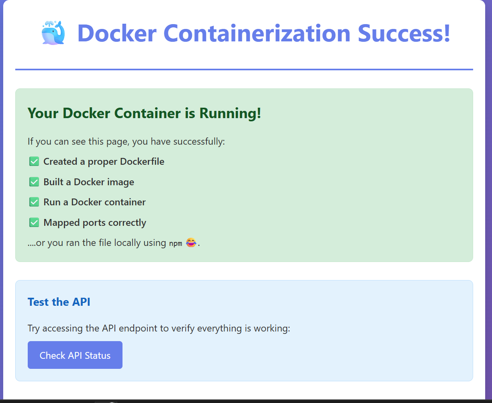
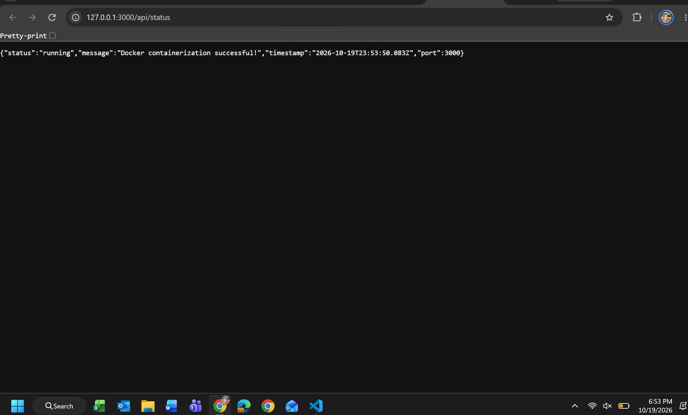

# Assignment #4: Application Containerization

This is a simple Node.js web application designed for learning Docker containerization concepts.

## Application Overview

This application is a basic Express.js web server that:
- Serves a static HTML page at the root (`/`)
- Provides an API status endpoint at `/api/status`
- Includes a health check endpoint at `/health`
- Runs on port 3000 by default (configurable via PORT environment variable)

## What's Included

- **app.js**: Main application server file
- **package.json**: Node.js dependencies and project configuration
- **public/index.html**: Static HTML page that confirms successful containerization
- **public/style.css**: Styling for the web page
- **Dockerfile**: Instructions for building the Docker image

## Running Without Docker (for reference only)

If you wanted to run this application directly (not required for assignment):
```bash
npm install
npm start
```

## Your Docker Assignment

**DO NOT MODIFY THE APPLICATION CODE**

Your task is to containerize this existing application using Docker. You need to:

1. Create a `Dockerfile` that properly containerizes this Node.js application
2. Build a Docker image from your Dockerfile
3. Run a container from your image
4. Verify the application works by accessing it in your browser

## Starting the Application

- To build the docker image run the command:

```bash
docker build -t sneha-docker-app .
```

This builds an image from the Dockerfile in the current folder (`.`) and tags it with the name `sneha-docker-app` (`-t`).

- To run your docker container in port 3000 run the command:

```bash
docker run -d -p 3000:3000 --name sneha-app sneha-docker-app
```

This starts a container from the `sneha-docker-app` image in detached mode (`-d`), maps port 3000 on my machine to port 3000 in the container (`-p 3000:3000`), and names the container `sneha-app`.

### Container Management

```bash
docker ps                # list running containers
docker stop sneha-app    # stop the container gracefully
docker ps -a             # list all containers, including stopped ones
docker start sneha-app   # start the stopped container again
docker stop sneha-app    # stop it before removing
docker rm sneha-app      # delete the container
```

## Screenshots

**Application running at localhost:3000**



**API response at localhost:3000/api/status**



## Reflection Question
**Answer the following question in the space below**: How does containerization with Docker differ from using virtual machines, and why might a development team choose Docker containers over VMs for deploying applications like the one you just containerized?

A virtual machine emulates an entire computer. Each VM runs its own full guest operating system on top of a hypervisor, so it includes its own kernel, system libraries, and background services. That makes VMs strongly isolated, but also heavy: they take up gigabytes of disk space, use a fixed share of memory and CPU, and can take minutes to boot.

A Docker container takes a lighter approach. Containers share the host machine's operating system kernel and only package the application plus what it needs to run, such as the runtime, libraries, and dependencies. For this assignment, the image contained Node.js 16, the npm packages, and the app code, and nothing else. Because there is no separate operating system to boot, a container starts in seconds and uses far fewer resources, so many containers can run on one machine.

A development team would likely choose containers over VMs for an app like this one for several reasons:

- **Consistency:** The Dockerfile defines the exact environment, so the app runs the same on every developer's laptop, in testing, and in production. This removes the "it works on my machine" problem. I was able to run a Node.js app without installing Node.js myself.
- **Speed:** Images build quickly thanks to layer caching, and containers start almost instantly, which speeds up development and deployment.
- **Efficiency:** Containers use less memory and storage than VMs, which lowers infrastructure costs.
- **Portability and automation:** The same image can run on any machine with Docker, which makes containers a natural fit for CI/CD pipelines and cloud platforms.
- **Scalability:** Since containers are lightweight, teams can quickly run more copies of an app to handle more traffic.

VMs still make sense when an app needs a different operating system than the host or stronger isolation, but for a small web app like this one, containers are faster, lighter, and easier to share.

## Application Requirements for Docker

Your Dockerfile should ensure:
- The application has Node.js runtime available
- All application files are copied into the container
- Dependencies are installed (`npm install`)
- Port 3000 is exposed
- The application starts with `npm start`
- The container can be accessed from your host machine

## Verification

When your Docker container is running correctly:
- Navigate to `http://localhost:3000` (or whatever port you mapped)
- You should see a success page confirming containerization worked
- The `/api/status` endpoint should return JSON status information

## Troubleshooting Tips

- Make sure your port mapping is correct in the `docker run` command
- Check that all files are copied into the container
- Verify Node.js dependencies are installed in the container
- Use `docker logs <container-name>` to see application output

## File Structure
```
docker-assignment/
├── Dockerfile          # Created for this assignment
├── app.js              # Provided
├── package.json        # Provided
├── public/             # Provided
│   ├── index.html      # Provided
│   └── style.css       # Provided
├── screenshots/        # Screenshots of the running app
│   ├── homepage.png
│   └── api-status.png
└── README.md           # This file
```